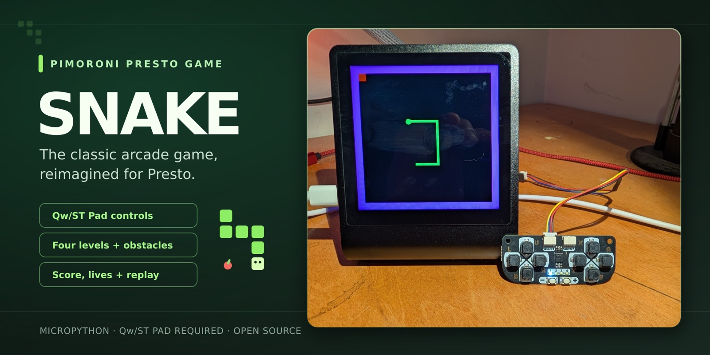

# Presto Snake

**Classic Snake for the Pimoroni Presto.** Steer with the Qw/ST Pad, eat the food, dodge the walls, and work through four levels.

[Install](#quick-start) · [Controls](#controls--gameplay) · [♥ Support this project](#support-development)

The [Pimoroni Presto](https://shop.pimoroni.com/products/presto) has a touchscreen, but **this game does not use it**. It is played with the external [Qw/ST Pad](https://shop.pimoroni.com/products/qwst-pad) controller.

## What you need

- [Pimoroni Presto](https://learn.pimoroni.com/article/getting-started-with-presto) running the official [Presto MicroPython firmware](https://github.com/pimoroni/presto/releases)
- [Qw/ST Pad](https://shop.pimoroni.com/products/qwst-pad) controller (at its default I2C address)
- A Qw/ST (Qwiic/STEMMA QT compatible) cable to connect the pad to the Presto
- A USB cable and a computer with [Thonny](https://thonny.org)
- The [`qwstpad`](https://github.com/pimoroni/qwstpad-micropython) MicroPython library

The `presto` module is part of Pimoroni's firmware. `qwstpad` is a separate library, so install it if `import qwstpad` fails.

## Quick start

Full steps and troubleshooting are in [docs/INSTALL.md](docs/INSTALL.md). In short:

1. Download or clone this repository.
2. Plug the Qw/ST Pad into the Presto's Qw/ST port, then connect the Presto to your computer over USB.
3. In Thonny, select the **MicroPython (Raspberry Pi Pico)** interpreter and open **View → Files**.
4. Install the `qwstpad` library (see [INSTALL.md](docs/INSTALL.md#2-install-the-qwstpad-library)).
5. Upload `src/snake.py` and `src/level-0.txt` to `src/level-3.txt` to the **same folder** (the top level of the Presto filesystem).
6. Reset the Presto. **Presto Snake** appears in the launcher carousel. Tap it to play.

Snake doesn't replace or modify the Presto's launcher `main.py`. Reset the Presto to get back to the carousel.

## Controls & gameplay

| Button | Action |
| --- | --- |
| **U** / **D** / **L** / **R** | Turn the snake up / down / left / right |
| **+** | Start from the title screen, or continue past the score and game over screens |
| **-** | Pause / resume while playing |
| Any other button | Nothing |

The title, level, lives, score and game over screens also advance on their own after a short delay, so `+` just skips the wait.

- **Goal:** Eat the red food. Each piece grows the snake by one and adds one point, and the snake speeds up as your score rises.
- **Crashing:** Hitting a purple wall or your own body ends the round. The edges of the screen wrap around, so they are safe.
- **Levels:** There are four layouts (`level-0` is an open field). Score **more than 5** before crashing to move on automatically to the next level. After level 3 the game wraps back to level 0.
- **Lives:** You start with 3. Crashing with 5 points or fewer costs a life, and at 0 lives the game ends and returns to the title screen.

### Known limitations

- No touchscreen input, on-screen pause message or high score.

## Level files

Levels are plain text grids, 20 columns wide. A `0` is a wall and anything else is empty. Edit the `level-N.txt` files to design your own, but keep them next to the game file.

## More Projects

**Pimoroni & Maker Projects:** [Presto AI Dash](https://github.com/jake1164/presto-ai-dash) (AI usage dashboard) · [Awesome Pimoroni Presto](https://github.com/jake1164/awesome-Pimoroni-Presto) (curated Presto links) · [Pico RGB Matrix Weather Clock](https://github.com/jake1164/Pico-RGB-Matrix-Weather-Clock) · [Tempest LED Weather Clock](https://github.com/jake1164/tempest-led-weather-clock)

**Other Software:** [Family Librarian](https://github.com/jake1164/family-librarian) (family ebook and audiobook requests) · [M3Undle](https://github.com/Sydney-Elvis/M3Undle) (IPTV lineup manager and proxy)

## Support Development

If you enjoy Presto Snake, a GitHub star helps others find it. Sponsorships and coffee donations are entirely optional. They help pay for development, maintenance and hardware experiments.

## License

[MIT](LICENSE)
